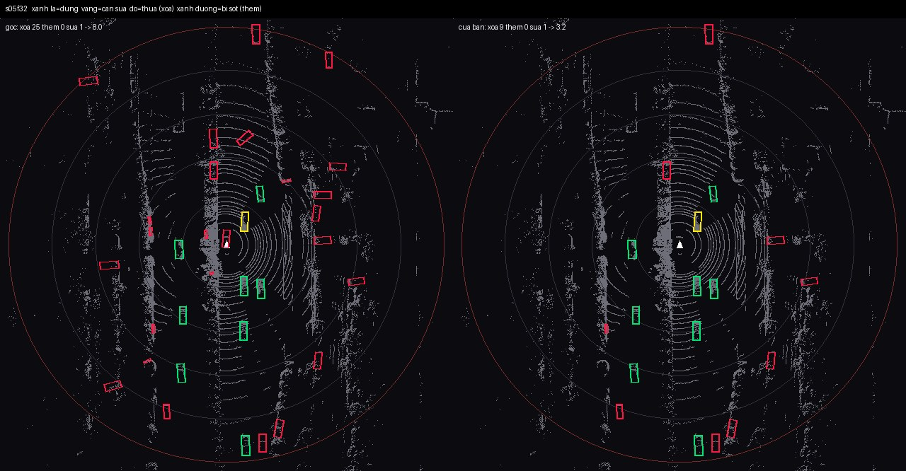

# Báo cáo Day 14 — Tạ Ngọc Huyền Trang — 2A202603251

- Mã học viên dùng với `--student`: `251`
- `seed_tag` trong `frames_A.txt`: `393590736f`

## 1. Dự đoán trước sweep (bước 5b)

- Tham số tôi nghĩ giảm công sửa nhiều nhất: Tăng `score_thr` (từ 0.1 lên 0.3 hoặc 0.4) kết hợp tăng `min_points` (từ 0 lên 5 hoặc 10).
- Vì sao (nhìn ảnh BEV tập A: box thừa nhiều hay box sót nhiều?): Khi quan sát ảnh BEV tập A và số đo thực tế từ cấu hình gốc, model sinh ra rất nhiều box thừa ở các vùng nhiễu (xóa tới 54 box trên tổng số 83 box dự đoán, chỉ có 29 box khớp thật, chiếm tới 16.2 điểm chi phí sửa). Trong khi đó, số box thật bị bỏ sót rất ít (chỉ thêm 3 box). Các box thừa này chủ yếu có điểm tin cậy thấp hoặc chứa rất ít điểm LiDAR. Do đó, việc tăng `score_thr` và lọc `min_points` sẽ loại bỏ được phần lớn các box thừa điểm thấp này mà hầu như không làm mất vật thể thật, giúp giảm chi phí công sửa nhiều nhất.

## 2. Tập A: sửa tay và tune

| Cấu hình | Xóa | Thêm | Sửa | Chi phí |
|---|---:|---:|---:|---:|
| Gốc | 54 | 3 | 7 | 22.7 |
| `best_config.json` | 18 | 6 | 6 | 14.4 |

- Tham số đã đổi trong `best_config.json`: `score_thr` tăng từ `0.1` lên `0.5`, `min_points = 0`.
- Kết quả leave-one-out (dán các dòng `scripts/pp_sweep.py` in ra):
  ```text
  s02f02: cấu hình chọn {'score_thr': '0.5', 'min_points': '0'} → 6.6 (tốt nhất có thể 6.6)
  s03f12: cấu hình chọn {'score_thr': '0.5', 'min_points': '0'} → 4.6 (tốt nhất có thể 4.6)
  s05f32: cấu hình chọn {'score_thr': '0.5', 'min_points': '0'} → 3.2 (tốt nhất có thể 3.2)
  ```
- Cấu hình có ổn định trên từng frame không? Vì sao tôi vẫn chọn (hoặc không chọn) nó: Cấu hình rất ổn định. Trên cả 3 lượt kiểm tra chéo leave-one-out, cấu hình được chọn khi train trên 2 frame bất kỳ luôn đem lại chi phí bằng đúng mức tối ưu (oracle) trên frame kiểm tra còn lại. Do đó tôi tự tin chọn cấu hình này để áp dụng cho tập B.

## 3. Trước/sau (bước 8)



- `scripts/pp_compare.py` báo giảm 37% công sửa trên tập A (tổng chi phí giảm từ 22.7 xuống 14.4).
- Dự đoán ở mục 1 đúng hay sai? Giải thích bằng số box xóa/thêm/sửa: Dự đoán ở mục 1 là hoàn toàn ĐÚNG. Khi tăng `score_thr` từ 0.1 lên 0.5, số box thừa cần xóa giảm mạnh từ 54 xuống còn 18 box (tiết kiệm được 36 × 0.3 = 10.8 điểm). Mặc dù có làm phát sinh thêm 3 box bị sót cần thêm mới (tăng 3 × 1.0 = 3.0 điểm), tổng công sửa vẫn giảm đáng kể nhờ mức giảm xóa vượt trội.

## 4. Tập B

Số đo từ `scripts/pp_prelabel.py --frames d14_251/frames_B.txt --config d14_251/best_config.json --gt d14_251/ref_B.json`:

| Xóa | Thêm | Sửa | Chi phí |
|---:|---:|---:|---:|
| 49 | 8 | 1 | 23.2 |

- Loại box tốn công sửa nhất ở tập B: Xét về tổng chi phí thì thao tác Xóa chiếm tỷ trọng lớn nhất (49 box thừa tương đương 14.7 điểm chi phí do các phản xạ nhiễu ở lề đường/tán cây xa). Tuy nhiên, xét theo đơn vị công sức thao tác thì việc Thêm box bị sót tốn nhiều công nhất (mỗi box thêm tốn 1.0 điểm, tổng 8.0 điểm cho 8 box), chủ yếu là các đối tượng nhỏ như Cyclist/Pedestrian hoặc xe bị che khuất mà model KITTI bỏ qua.

## 5. Giới hạn

- Nêu ít nhất 2 giới hạn:
  1. Chỉ có 3 frame để tune siêu tham số ở tập A, số lượng mẫu còn nhỏ nên vẫn có rủi ro chưa bao quát hết mọi điều kiện giao thông phức tạp.
  2. Model PointPillars huấn luyện trên KITTI chỉ có 3 lớp (Car, Cyclist, Pedestrian), không có lớp Truck và Bus, dẫn đến các phương tiện cỡ lớn của xe VinFast bị dự đoán nhầm thành Car hoặc bị chia cắt thành nhiều box nhỏ, đòi hỏi người gán nhãn phải can thiệp sửa lớp và kích thước bằng tay.
  3. Công thức chi phí (0.3·xóa + 1.0·thêm + 0.5·sửa) chỉ là xấp xỉ đánh giá, chưa phản ánh chính xác 100% thời gian thao tác thực tế của người gán nhãn trên giao diện 3D.
